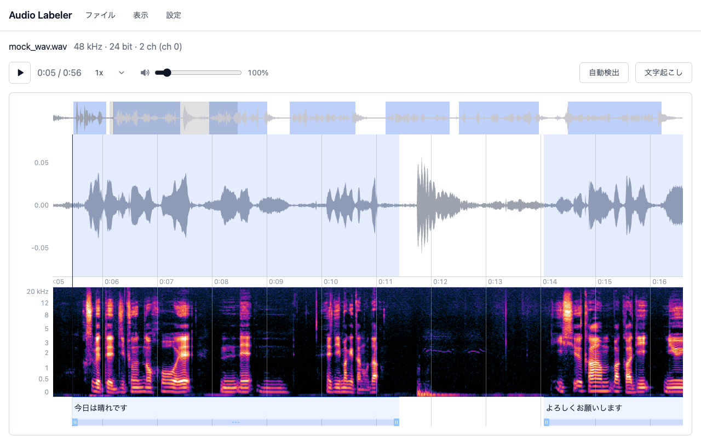

# audio-labeler

音声ファイルに `開始秒 / 終了秒 / ラベル` の区間ラベルを付けるための、ブラウザで動くラベリングツールです。
発話区間のアノテーションや、区間ごとの音声の切り出しに使います。

- 波形を見ながら、ドラッグで区間を作ってラベルを入力
- **Silero VAD** で発話区間を自動検出、**Whisper** で各区間を自動で文字起こし
- ラベルはタブ区切りのテキストで読み書きでき、途中から作業を再開できる
- 区間ごとに音声を切り出して ZIP で書き出し



## 目次

- [必要なもの](#必要なもの)
- [起動と停止](#起動と停止)
- [使い方](#使い方)
- [ドキュメント](#ドキュメント)
- [ライセンス](#ライセンス)

## 必要なもの

- [Docker](https://www.docker.com/)(Docker Compose を含む)
- Chrome / Edge を推奨(保存先を選んで書き出せます。他のブラウザではダウンロードフォルダに保存されます)

## 起動と停止

### 初めて起動する

自動検出・文字起こしを使うかどうかで、どちらか1つを実行します。

```bash
./build.sh --full
```

```bash
./build.sh --base
```

|                                    | `--full`                                       | `--base`                   |
| ---------------------------------- | ---------------------------------------------- | -------------------------- |
| 手でラベルを付ける・書き出す       | できる                                         | できる                     |
| 発話区間の自動検出(Silero VAD)     | できる                                         | できない(ボタンも出ない)   |
| 文字起こし(Whisper)                | できる                                         | できない(ボタンも出ない)   |
| ディスクの使用量(イメージの大きさ) | 約 1.75GB(PyTorch を含む)                      | 約 430MB                   |
| こんな人に                         | 自動検出・文字起こしを使いたい人、迷っている人 | 手でラベルを付けるだけの人 |

コマンドが終わるとアプリが起動しています。http://localhost:5173 をブラウザで開いてください。

> [!NOTE]
> `--full` で文字起こしを初めて使うときは、Whisper のモデル(1GB 以上)をダウンロードするため数分かかります。モデルは Docker ボリュームに残るので、2回目以降はダウンロードしません。

### 2回目からの起動と停止

選んだ種類は `.env` に記録されるので、次からは種類を指定しません。

```bash
./start.sh
```

```bash
./stop.sh
```

`./stop.sh` で止めたあとは Docker Desktop の再生ボタンでも同じように起動できます。

| サービス     | URL                   |
| ------------ | --------------------- |
| フロント     | http://localhost:5173 |
| バックエンド | http://localhost:8000 |

### あとから種類を変える

`--base` で始めたあとで自動検出・文字起こしを使いたくなったら、`--full` を付けて作り直します。足りない分だけをインストールします。

```bash
./build.sh --full
```

`--full` から `--base` に戻すときは `--base` を付けて作り直します。

作り直すと、読み込んでいた音声は消えます。ラベルを書き出してから作り直し、終わったらブラウザを再読み込みしてください。設定はブラウザに保存されているので残ります。

### 更新したとき

`git pull` などでこのリポジトリを更新したら、種類を指定せずに `./build.sh` で作り直してください。前回と同じ種類で作り直します。`./start.sh` と Docker Desktop の再生ボタンは、前に作ったものをそのまま起動するだけなので、更新した中身が入らないことがあります。

```bash
./build.sh
```

## 使い方

1. 「音声ファイルを選択」で `.wav` を選び、読み込みのダイアログで「読み込む」(自動検出・文字起こしもここで選べます)
2. 波形をドラッグして範囲を選び、<kbd>⌘</kbd> + <kbd>B</kbd>(Windows は <kbd>Ctrl</kbd> + <kbd>B</kbd>)でラベルを入力して <kbd>Enter</kbd>
3. 波形の下のラベル帯・調整帯で区間を選んで直す
4. 「ファイル」→「ラベルを書き出す」でタブ区切りのテキストを保存

詳しい操作は [docs/](docs/README.md) を見てください。

## ドキュメント

| ドキュメント                                  | 内容                                                       |
| --------------------------------------------- | ---------------------------------------------------------- |
| [画面構成と用語](docs/screen.md)              | 編集画面の各部の名前と役割                                 |
| [操作方法](docs/usage.md)                     | 読み込みから区間の編集、自動検出・文字起こし、書き出しまで |
| [キーボードショートカット](docs/shortcuts.md) | 全ショートカットの一覧と挙動                               |
| [設定](docs/settings.md)                      | 設定ダイアログ・「表示」メニュー・再生欄の全項目と既定値   |
| [ファイル形式](docs/file-formats.md)          | ラベルファイルと、音声の切り出し(ZIP)の中身                |
| [PLAN.md](PLAN.md)                            | 要件・設計方針(開発者向け。仕様を決めた理由もここ)         |

## ライセンス

[MIT License](LICENSE)
