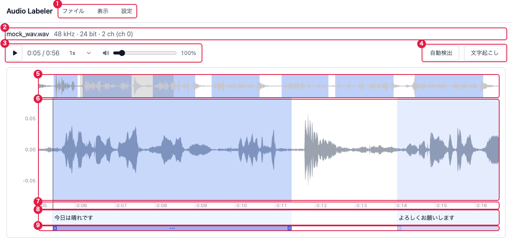
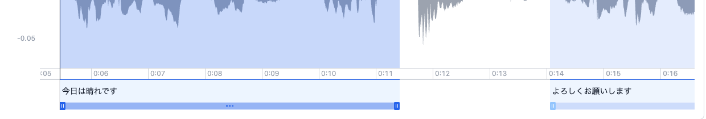

# 画面構成と用語

## 画面の流れ

アプリには2つの画面があります。

1. **ホーム画面**: 音声ファイルを選ぶだけの画面。選ぶと [読み込みのダイアログ](usage.md#1-音声を開く) が開きます
2. **編集画面**: 音声を読み込んだ後の画面。以降の操作はすべてここで行います

設定や確認は画面を切り替えず、編集画面の上にダイアログで開きます。

## 編集画面

| 番号 | 名前         | 役割                                                                                                                                 |
| ---- | ------------ | ------------------------------------------------------------------------------------------------------------------------------------ |
| 1    | ヘッダー     | 「ファイル」「表示」メニューと「設定」ボタン                                                                                         |
| 2    | ファイル情報 | ファイル名と、元ファイルのサンプリング周波数・ビット深度・チャンネル数。2ch 以上のときは表示中のチャンネルを `(ch 0)` のように添える |
| 3    | 再生欄       | 再生 / 一時停止ボタン、再生位置 / 長さ、再生の速さ、音量                                                                             |
| 4    | 処理ボタン   | 「自動検出」「文字起こし」。実行中は進み具合の表示と中止ボタンを兼ねる                                                               |
| 5    | 全体波形     | 音声全体を縮小した波形。メイン波形に出している範囲が灰色で重なる。ドラッグ・ホイールで表示位置を動かす(シークはしない)               |
| 6    | メイン波形   | 拡大した波形。クリックでシーク、ドラッグで選択範囲を作る。左に振幅の目盛り                                                           |
| 7    | 時間の目盛り | メイン波形の表示範囲の時刻(分:秒)。拡大率に合わせて間隔が変わる                                                                      |
| 8    | ラベル帯     | 区間のラベル(文言)。クリックで区間を選ぶ、ダブルクリックで文言を編集                                                                 |
| 9    | 調整帯       | 区間の位置と幅。選択中の区間だけ、中央のドラッグで移動、両端のつまみで幅を変えられる                                                 |

「表示」メニューでスペクトログラムをオンにすると、7 と 8 の間にスペクトログラムが入ります([設定 > 「表示」メニュー](settings.md#表示メニュー))。

## 用語

ほかのドキュメントは、次の用語で書いています。

| 用語         | 意味                                                                                                                                       |
| ------------ | ------------------------------------------------------------------------------------------------------------------------------------------ |
| 区間         | `開始秒・終了秒・ラベル` の組。ラベルファイルの1行にあたる。区間同士は重ならない                                                           |
| ラベル       | 区間に付ける文言(文字起こしなど)。空でもよい                                                                                               |
| 選択範囲     | メイン波形をドラッグして作る、区間になる前の範囲(オレンジ)。<kbd>⌘</kbd> + <kbd>B</kbd> でラベルを付けると区間になる。範囲の再生にも使える |
| 選択中の区間 | ラベル帯・調整帯のクリックや <kbd>←</kbd> / <kbd>→</kbd> で選んだ区間(1つだけ)。削除・結合・境界をずらすなどのキー操作の対象になる         |
| 再生位置     | 再生を始める位置。メイン波形に縦線(カーソル)で出る                                                                                         |
| 表示位置     | メイン波形にどの時刻の範囲を出しているか。再生位置とは別に動く                                                                             |
| 未入力の区間 | ラベルが空の区間。「表示」メニューで色分けできる                                                                                           |
| プリセット   | 自動検出(Silero VAD)の検出パラメータの組に名前を付けたもの。設定ダイアログで作る                                                           |

## 区間の色

| 色                           | 状態                                                                 |
| ---------------------------- | -------------------------------------------------------------------- |
| 青                           | 普段の区間                                                           |
| 濃い青(調整帯につまみが出る) | 選択中の区間                                                         |
| オレンジ                     | 選択範囲                                                             |
| 赤系                         | 未入力の区間(「表示」メニューの「未入力の区間を色分け」がオンのとき) |
| 灰色                         | 自動検出・文字起こしの実行中(操作できない)                           |
| 緑 / 濃い緑                  | 文字起こしの処理済み / 処理中の区間。自動検出の途中経過              |

