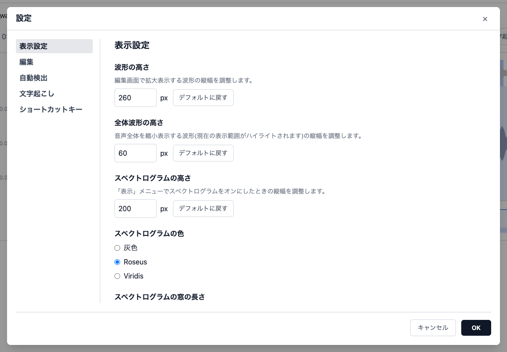
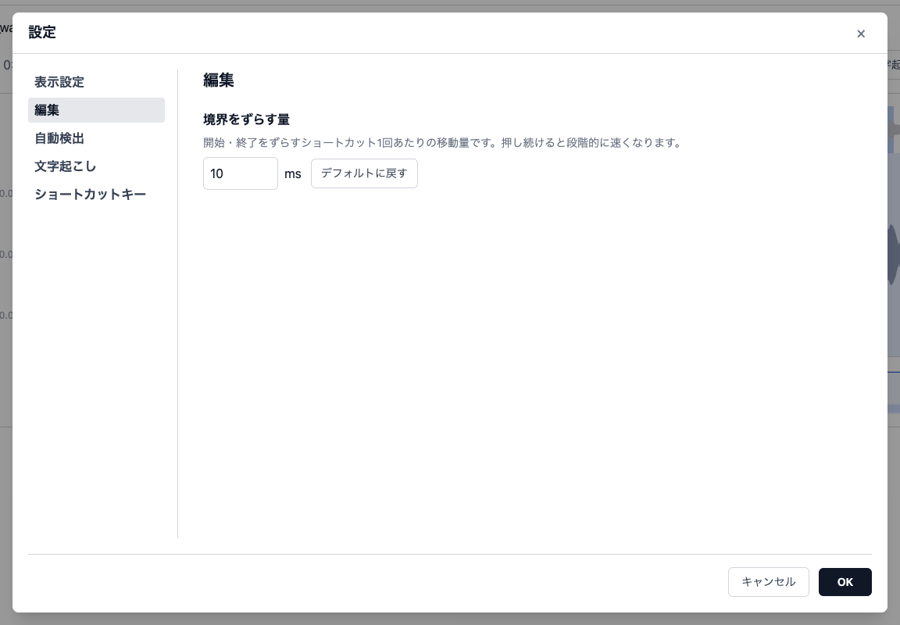
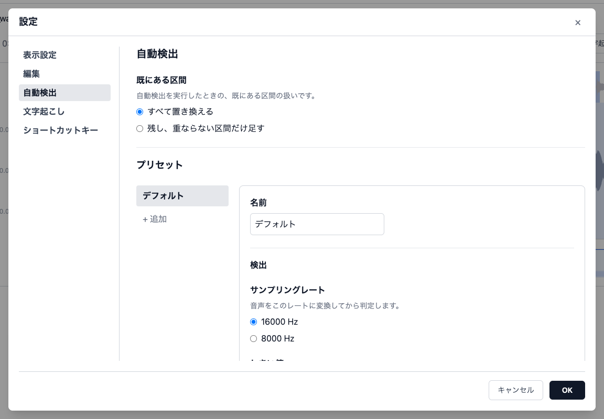
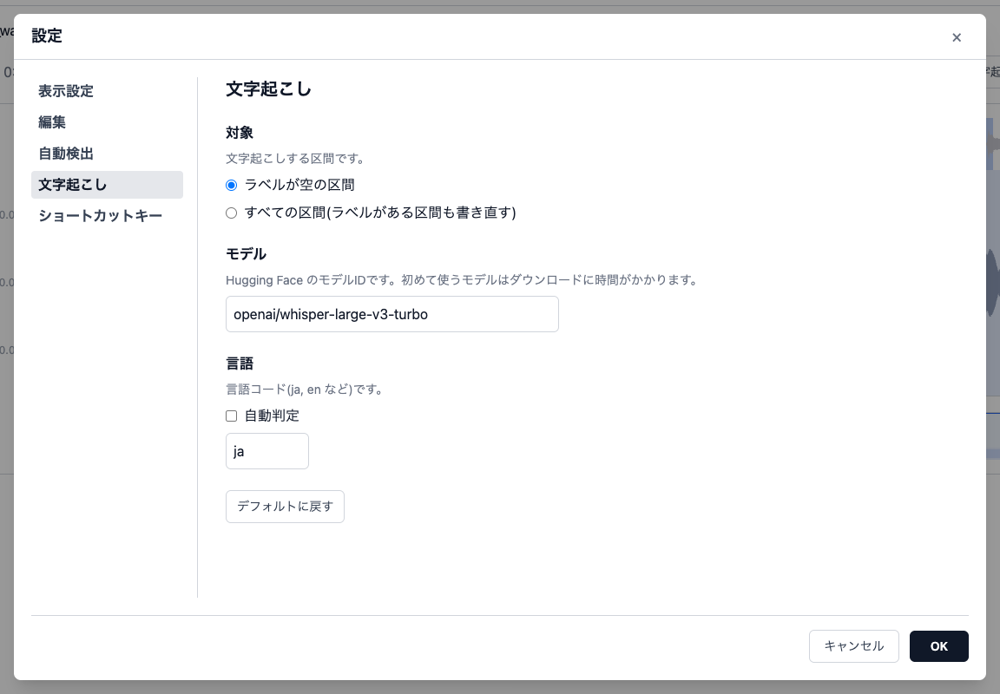
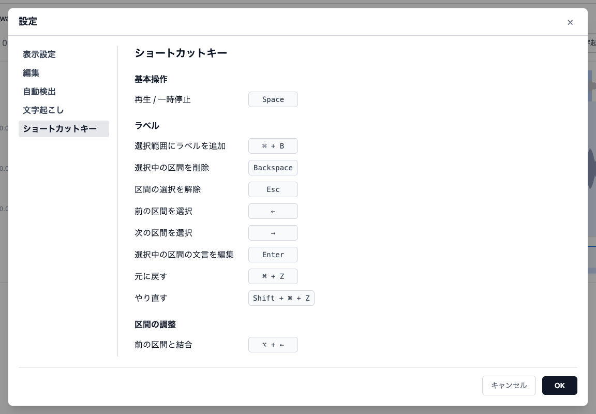
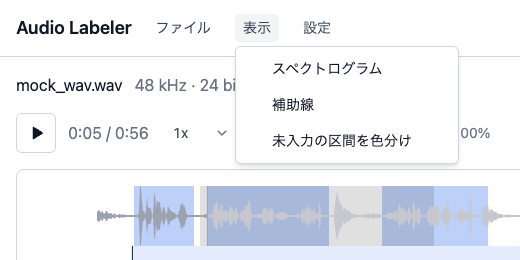
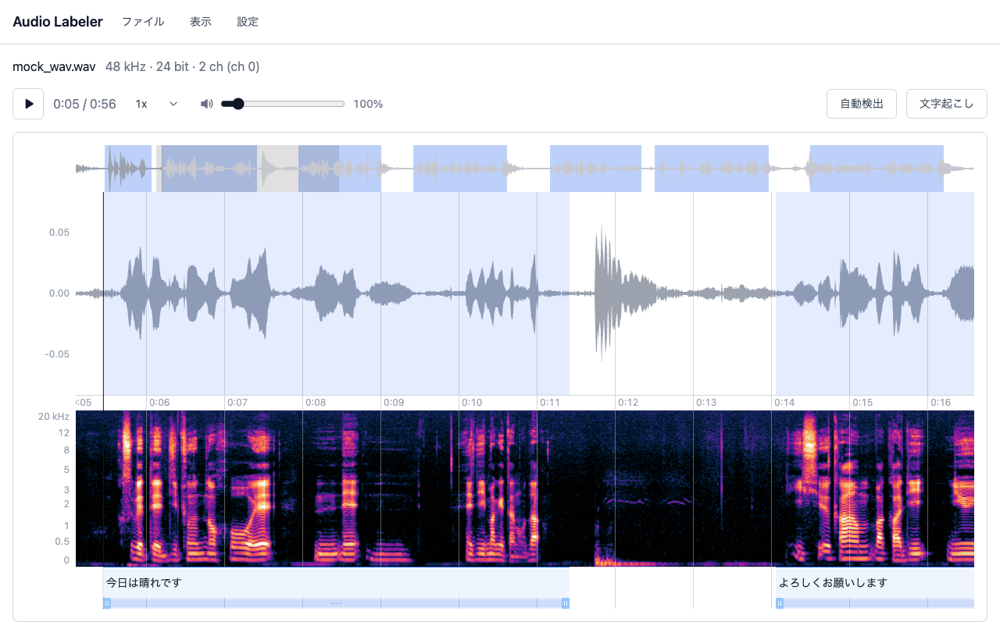

# 設定

設定を変える場所は3つあり、変える頻度で分けています。同じ項目が2か所に出ることはありません。

| 場所                              | 置いているもの                              | 反映のタイミング   |
| --------------------------------- | ------------------------------------------- | ------------------ |
| [設定ダイアログ](#設定ダイアログ) | 一度決めたらあまり変えないもの              | 「OK」を押したとき |
| [「表示」メニュー](#表示メニュー) | 作業中に切り替えて見比べる表示のオン / オフ | 押したとき         |
| [再生欄](#再生欄)                 | 作業中に聞きながら変える再生の速さ・音量    | 変えたとき         |

どの設定もブラウザ(localStorage)に保存され、リロードしても残ります。ブラウザごと・利用者ごとの設定で、ほかの人とは共有されません。保存先のキーは [保存先](#保存先) にまとめています。

## 設定ダイアログ

ヘッダーの「設定」で開きます。自動検出・文字起こしの実行中は開けません。

- 変更は「OK」を押したときにまとめて反映します。「キャンセル」・×・<kbd>Esc</kbd>・背景のクリックで閉じたときは、変更を捨てます
- 入力に誤りがあるとき(プリセットの名前が空など)は、ボタンの横に理由が出て「OK」を押せません

### 表示設定

| 項目                       | 選択肢・範囲                                             | 既定値               |
| -------------------------- | -------------------------------------------------------- | -------------------- |
| 波形の高さ                 | 150〜800 px                                              | 600 px               |
| 全体波形の高さ             | 30〜150 px                                               | 60 px                |
| スペクトログラムの高さ     | 100〜600 px                                              | 200 px               |
| スペクトログラムの色       | 灰色 / Roseus / Viridis                                  | Roseus               |
| スペクトログラムの窓の長さ | 3 / 5 / 8 / 15 / 30 / 42 ms                              | 42 ms                |
| 再生中の表示               | 端に来たらページ送り / カーソルを中央に保つ / 動かさない | 端に来たらページ送り |

- **スペクトログラムの窓の長さ**: 短いほど時間方向が細かく(区間の境界や子音の始まりを見るときは 8ms など)、長いほど周波数方向が細かく(倍音・フォルマントが見える)なります。変えると音声全体を計算し直します(25分・48kHz の音声で十数秒)
- **再生中の表示**: 「端に来たらページ送り」では、再生位置が表示範囲の外に出たら、再生位置が左端から表示幅の 3% 内側に来るように表示位置を動かします

### 編集

| 項目           | 範囲       | 既定値 |
| -------------- | ---------- | ------ |
| 境界をずらす量 | 1〜1000 ms | 10 ms  |

開始 / 終了をずらすショートカット1回あたりの移動量です。押し続けたときの加速は [キーボードショートカット](shortcuts.md#開始--終了をずらす) を見てください。

### 自動検出

#### 既にある区間

「音声全体」で自動検出したときの、既にある区間の扱いです。すべてのプリセットで共通です。

| 選択肢                       | 動作                                                     |
| ---------------------------- | -------------------------------------------------------- |
| すべて置き換える(既定)       | 区間があれば確認を出してから、検出結果ですべて置き換える |
| 残し、重ならない区間だけ足す | 既にある区間を残し、重ならない検出結果だけを足す         |

「選んだ区間」で検出するときは、この設定は使いません(選んだ区間を置き換えます)。

#### プリセット

検出パラメータの組に名前を付けたものです。実行するときに名前で選びます。左の一覧で選んだプリセットの名前と値を、右の枠の中で変えます。

- **「+ 追加」**: 今開いているプリセットの値を写して、新しいプリセットを作ります
- **削除**: 一覧の各行の × で消します(開いている行と、カーソルを当てた行だけに出ます)。最後の1つは消せません
- **名前**: 空・重複はできません。直すところがあるプリセットは、一覧で赤字になります
- **「値をデフォルトに戻す」**: 名前はそのままで、値だけを既定値に戻します
- 組み込みのプリセットは「デフォルト」の1つだけです。消したり名前を変えたりもできます
- プリセットはファイルへの書き出し・読み込みはできません(ブラウザにだけ保存されます)

プリセットごとに持つ値は次のとおりです。Silero VAD の `get_speech_timestamps` の引数のうち、結果に影響するものをすべて変えられます。

| まとまり       | 項目                             | 内容                                                                                                 | 既定値   | 対応する引数                     |
| -------------- | -------------------------------- | ---------------------------------------------------------------------------------------------------- | -------- | -------------------------------- |
| 検出           | サンプリングレート               | 音声をこのレートに変換してから判定する(16000 / 8000 Hz)                                              | 16000 Hz | `sampling_rate`                  |
|                | しきい値                         | 発話らしさがこれを超えると発話とみなす(0.05〜0.95)                                                   | 0.25     | `threshold`                      |
|                | 終了のしきい値                   | 発話中に発話らしさがこれを下回ると終わりとみなす。しきい値以下にする。「自動」はしきい値 − 0.15      | 0.25     | `neg_threshold`                  |
|                | 最短の発話                       | これより短い発話は検出しない(0〜5000 ms)                                                             | 200 ms   | `min_speech_duration_ms`         |
|                | 最短の無音                       | これより短い無音では区間を分けない(0〜5000 ms)                                                       | 500 ms   | `min_silence_duration_ms`        |
|                | 前後の余白                       | 検出した区間の前後に足す長さ(0〜1000 ms)                                                             | 250 ms   | `speech_pad_ms`                  |
| 長い発話の分割 | 最長の発話                       | これより長い発話は途中で分割する(1〜600 秒)                                                          | 無制限   | `max_speech_duration_s`          |
|                | 分割に使う最短の無音             | 分割するとき、この長さ以上の無音の位置で分ける(最長の発話が無制限のときは使わない)                   | 98 ms    | `min_silence_at_max_speech`      |
|                | できるだけ長い無音の位置で分ける | オン / オフ                                                                                          | オン     | `use_max_poss_sil_at_max_speech` |
| 検出後の結合   | 結合する無音の長さ               | 前後の余白を足した後、間の無音がこれより短い区間をつなげる。0 なら結合しない(このアプリ独自の後処理) | 500 ms   | —                                |

既定値は、以前から使っていた VAD の設定に合わせています。それ以外の項目は Silero VAD の既定値です。

#### 前回使ったプリセット

実行時のダイアログ・読み込みのダイアログ・<kbd>⌘</kbd> + <kbd>D</kbd> の初期値は、前回使ったプリセットです。

- 「音声全体」と「選んだ区間」で別々に覚えます(全体は大まかに、区間の中は細かく、と使い分けるため)
- 「選んだ区間」で一度も実行していないときは、「音声全体」で前回使ったものになります
- 前回使ったプリセットを消したときは、一覧の先頭のプリセットになります

### 文字起こし

| 項目   | 内容                                                                    | 既定値                          |
| ------ | ----------------------------------------------------------------------- | ------------------------------- |
| 対象   | 「ラベルが空の区間」/「すべての区間(ラベルがある区間も書き直す)」       | ラベルが空の区間                |
| モデル | Hugging Face のモデル ID。fine-tune したモデルなども指定できる          | `openai/whisper-large-v3-turbo` |
| 言語   | 言語コード(`ja`、`en` など)、または「自動判定」(短い区間では外れやすい) | `ja`                            |

- 読み込みのダイアログでラベルを選んで文字起こしするときは、対象の設定にかかわらず、ラベルが空の区間だけを埋めます
- 初めて使うモデルはダウンロードに時間がかかります。ダウンロードしたモデルは Docker のボリュームに残ります

### ショートカットキー

全ショートカットの割り当てを変えられます。一覧と変え方は [キーボードショートカット](shortcuts.md) を見てください。

## 「表示」メニュー

ヘッダーの「表示」から、押すとすぐに切り替わります。

| 項目                 | 内容                                                                                                   | 既定値 |
| -------------------- | ------------------------------------------------------------------------------------------------------ | ------ |
| スペクトログラム     | メイン波形とラベル帯の間にスペクトログラム(Mel 軸、0〜20kHz)を出す。初めて出すときは計算に時間がかかる | オフ   |
| 補助線               | 時間の目盛りの位置に、メイン波形からラベル領域の下端まで縦線を引く                                     | オフ   |
| 未入力の区間を色分け | ラベルが空の区間を赤系の色にする(全体波形も含む)。未入力が残っている場所を探すとき用                   | オフ   |

- スペクトログラムの上でのクリック・ドラッグは、メイン波形の上と同じです(シーク・選択範囲)
- スペクトログラムの高さ・色・窓の長さは、設定ダイアログの「表示設定」で変えます

## 再生欄

編集画面の再生ボタンの右で変えます。変えるとすぐに反映します。自動検出・文字起こしの実行中も変えられます。

| 項目 | 選択肢・範囲                               | 既定値 |
| ---- | ------------------------------------------ | ------ |
| 速さ | 0.5 / 0.75 / 1 / 1.25 / 1.5 / 2 倍         | 1 倍   |
| 音量 | 0〜1000%(スピーカーのアイコンのスライダー) | 100%   |

- 速さを変えても音の高さは変わりません
- 波形は振幅を正規化して表示しているため、小さい録音は波形が大きく見えても聞くと小さい音です。そのため音量は 100% より上げられます(上げすぎると音が割れます)

## 読み込み・書き出しのダイアログの初期値

[読み込みのダイアログ](usage.md#1-音声を開く)と[音声の切り出しのダイアログ](usage.md#音声を切り出す)は、設定ダイアログには項目がなく、前回選んだ内容が次の初期値になります。

## 保存先

設定はすべてブラウザの localStorage に、次のキーで保存しています。設定を初期化したいときは、ブラウザの開発者ツールでこれらを消してください。

| キー                                       | 中身                                               |
| ------------------------------------------ | -------------------------------------------------- |
| `audio-labeler.displaySettings`            | 設定ダイアログの「表示設定」                       |
| `audio-labeler.editingSettings`            | 設定ダイアログの「編集」                           |
| `audio-labeler.vadSettings`                | 設定ダイアログの「自動検出」(プリセットを含む)     |
| `audio-labeler.lastUsedVadPresetId`        | 「音声全体」で前回使ったプリセット                 |
| `audio-labeler.lastUsedSegmentVadPresetId` | 「選んだ区間」で前回使ったプリセット               |
| `audio-labeler.transcriptionSettings`      | 設定ダイアログの「文字起こし」                     |
| `audio-labeler.shortcutBindings`           | ショートカットの割り当て(初期値から変えたものだけ) |
| `audio-labeler.viewOptions`                | 「表示」メニュー                                   |
| `audio-labeler.playbackSettings`           | 再生の速さ・音量                                   |
| `audio-labeler.lastAudioLoadChoices`       | 読み込みのダイアログで前回選んだ内容               |
| `audio-labeler.lastSegmentExportChoices`   | 音声の切り出しのダイアログで前回選んだ内容         |
