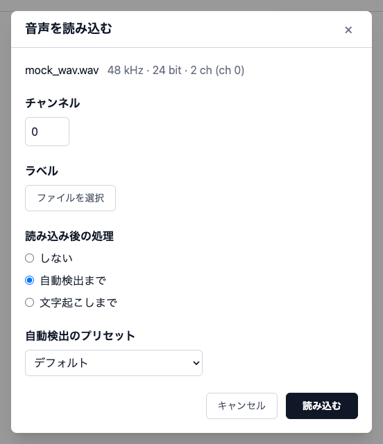
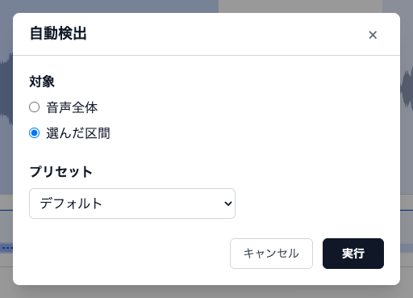
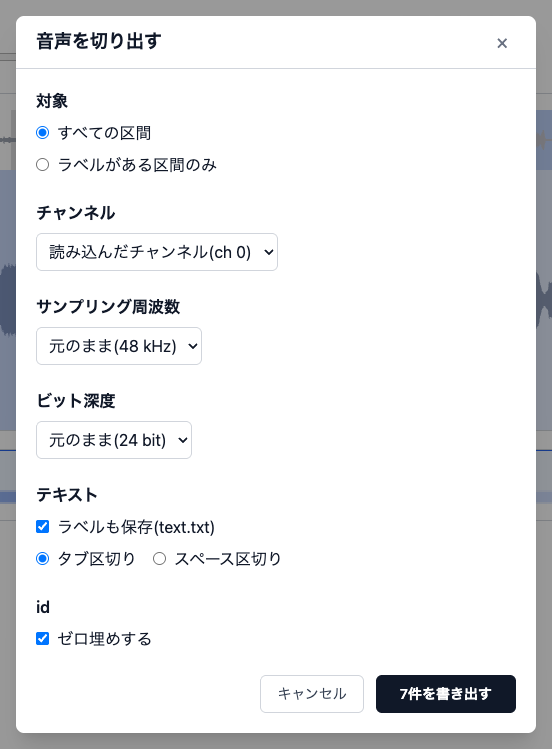

# 操作方法

音声を開いてから、ラベルを付けて書き出すまでの操作です。画面の各部の名前は [画面構成と用語](screen.md) を見てください。

- [1. 音声を開く](#1-音声を開く)
- [2. 再生と表示位置の移動](#2-再生と表示位置の移動)
- [3. 区間を作る](#3-区間を作る)
- [4. 区間を編集する](#4-区間を編集する)
- [5. 元に戻す / やり直す](#5-元に戻す--やり直す)
- [6. 自動検出(Silero VAD)](#6-自動検出silero-vad)
- [7. 文字起こし(Whisper)](#7-文字起こしwhisper)
- [8. 書き出す](#8-書き出す)
- [9. ラベルを読み込む(作業の再開)](#9-ラベルを読み込む作業の再開)

## 1. 音声を開く

ホーム画面で「音声ファイルを選択」、または編集画面で「ファイル」→「新規音声を読み込む」から `.wav` を選びます。対応している形式は `.wav` だけです。

ファイルを選ぶとアップロードが始まり、終わると読み込みのダイアログになります。チャンネル・ラベル・読み込み後の処理をここでまとめて決めてから「読み込む」を押します。

| 項目                 | 内容                                                                                                                                             |
| -------------------- | ------------------------------------------------------------------------------------------------------------------------------------------------ |
| チャンネル           | 2ch 以上の音声のときだけ出る。指定した1チャンネルだけを使う(平均してモノラルにはしない)。後から変えるときは音声を開き直す                        |
| ラベル               | 任意。ラベルファイルを選ぶと、その区間を復元した状態で開く。形式の誤り・区間の重なり・音声より長い区間があると、その場でエラーを出し読み込めない |
| 読み込み後の処理     | 「しない」/「自動検出まで」/「文字起こしまで」。ラベルを選んだときは「しない」/「文字起こし」だけ(ラベルが空の区間だけを埋める)                  |
| 自動検出のプリセット | 自動検出をするときだけ出る。使う[プリセット](settings.md#自動検出)を選ぶ                                                                         |

- 各項目の初期値は前回選んだ内容です。変えるものがなければ <kbd>Enter</kbd> で読み込めます
- アップロード中は進み具合が出ます。キャンセル(<kbd>Esc</kbd>・×も同じ)で中止でき、今開いている音声のまま変わりません
- 書き出していない変更があるときは、ファイルを選ぶ前に確認が出ます
- 「文字起こしまで」は、自動検出を中止した・失敗した・区間が0件だったときは文字起こしをしません

## 2. 再生と表示位置の移動

### 再生

- 再生ボタン、または <kbd>Space</kbd> で再生 / 一時停止します
- **選択範囲** または **選択中の区間** があるときは、その先頭から再生して末尾で止まります
- 再生の速さ(0.5〜2倍。音の高さは変わらない)と音量(0〜1000%)は再生欄で変えます。すぐ反映し、次回も残ります
- 再生中に表示位置をどう動かすかは [設定 > 表示設定](settings.md#表示設定) の「再生中の表示」で選びます(既定は端に来たらページ送り)

### シーク(再生位置の移動)

- メイン波形(とスペクトログラム)をクリックすると、その位置に再生位置が移ります
- 全体波形ではシークしません

### 表示位置の移動と拡大縮小

| 操作                                       | 結果                                 |
| ------------------------------------------ | ------------------------------------ |
| 全体波形をドラッグ / ホイール              | 表示位置を左右に動かす               |
| メイン波形の上で <kbd>⌘</kbd> + ホイール   | 横方向に拡大 / 縮小(最大 1秒 5000px) |
| 振幅の目盛りの上で <kbd>⌘</kbd> + ホイール | 縦方向(振幅)に拡大 / 縮小            |

## 3. 区間を作る

1. メイン波形をドラッグして **選択範囲** を作る
2. <kbd>⌘</kbd> + <kbd>B</kbd> でラベル入力を始める
3. 文字を入力して <kbd>Enter</kbd> で確定する(<kbd>Esc</kbd> で取り消し。選択範囲は残る)

- 既にある区間と重なる範囲では、入力を始める前にエラーが出ます
- ラベル中のタブ・改行は半角スペースに置き換わります
- 波形の中(ラベル領域を含む)を押すと、選択範囲は解除され、押した位置に再生位置が移ります。再生ボタンなど波形の外の操作では解除されません

## 4. 区間を編集する

確定した区間は、誤操作を防ぐため普段は表示だけです。ラベル帯か調整帯をクリックして **選択** したときだけ操作できます。

| やりたいこと             | マウス                                 | キー                                                                                                                  |
| ------------------------ | -------------------------------------- | --------------------------------------------------------------------------------------------------------------------- |
| 区間を選ぶ               | ラベル帯 / 調整帯をクリック            | <kbd>←</kbd> / <kbd>→</kbd>(前 / 次の区間)                                                                            |
| 選択を解除               | 波形の中をクリック                     | <kbd>Esc</kbd>                                                                                                        |
| 文言を編集               | ラベル帯をダブルクリック               | <kbd>Enter</kbd>(編集中は <kbd>Enter</kbd> で確定、<kbd>Esc</kbd> で取り消し)                                         |
| 移動                     | 調整帯の中央をドラッグ                 | —                                                                                                                     |
| 開始・終了を変える       | 調整帯の両端のつまみをドラッグ         | 開始: <kbd>⌘</kbd> + <kbd>Shift</kbd> + <kbd>←</kbd> / <kbd>→</kbd>、終了: <kbd>⌘</kbd> + <kbd>←</kbd> / <kbd>→</kbd> |
| 隣の区間と結合           | —                                      | <kbd>⌥</kbd> + <kbd>←</kbd> / <kbd>→</kbd>                                                                            |
| 削除                     | —                                      | <kbd>Backspace</kbd>                                                                                                  |
| 区間の中を自動検出し直す | 「自動検出」ボタン(対象「選んだ区間」) | <kbd>⌘</kbd> + <kbd>D</kbd>                                                                                           |

- 他の区間と重なる移動・幅の変更はエラーになり、区間は変わりません
- キー操作の細かい挙動(押し続けたときの加速、結合したときのラベルなど)は [キーボードショートカット](shortcuts.md) を見てください
- キー操作で表示範囲の外の区間を変えたときは、その場所まで表示位置が動きます(再生中は動きません)
- 境界を動かしたときは、その位置に縦線が1秒ほど出ます。10ms ずらしたのを戻したときなど、見ても気づけない変化を確かめるためです

## 5. 元に戻す / やり直す

区間に対する変更は、1操作ずつ元に戻せます。ボタンはなく、キーで行います。

- 元に戻す: <kbd>⌘</kbd> + <kbd>Z</kbd>
- やり直す: <kbd>⌘</kbd> + <kbd>Shift</kbd> + <kbd>Z</kbd>(Windows 等は <kbd>Ctrl</kbd> + <kbd>Y</kbd>)

| 対象になる変更                                                       | 対象にならないもの           |
| -------------------------------------------------------------------- | ---------------------------- |
| 区間の追加・文言の編集・移動・幅の変更・結合・削除・ラベルの読み込み | 選択範囲・再生位置・表示位置 |
| 自動検出・文字起こしの結果(1回の実行ぶんをまとめて1回で戻る)         |                              |
| 開始 / 終了をずらすキーの押し続け(押し続けた分をまとめて1回で戻る)   |                              |

- ラベルの入力中は、入力欄の中の文字の取り消しになります
- 新しい音声を読み込むと履歴は消えます

## 6. 自動検出(Silero VAD)

発話区間を検出し、ラベルが空の区間として追加します。

1. 「自動検出」ボタンを押す
2. ダイアログで対象とプリセットを選び、「実行」(<kbd>Enter</kbd>)

| 項目       | 内容                                                                                                                               |
| ---------- | ---------------------------------------------------------------------------------------------------------------------------------- |
| 対象       | 区間を選んでいるときだけ出る。「音声全体」/「選んだ区間」(既定)                                                                    |
| プリセット | 検出パラメータの組。初期値は、その対象で前回使ったプリセット。プリセットの作成・編集は[設定ダイアログ](settings.md#自動検出)で行う |

### 対象ごとの結果

- **音声全体**: 既にある区間の扱いは [設定 > 自動検出](settings.md#自動検出) の「既にある区間」に従います
  - 「すべて置き換える」(既定): 区間があれば確認を出してから、すべて置き換えます
  - 「残し、重ならない区間だけ足す」: 既にある区間と重ならない検出結果だけを足します
- **選んだ区間**: その区間を、区間の中で見つかった区間で置き換えます(範囲の外には広げません)。ラベルがあるときは確認が出ます(ラベルは引き継がれません)

### ショートカットでの実行

- <kbd>⌘</kbd> + <kbd>D</kbd>: 選択中の区間を、「選んだ区間」で前回使ったプリセットですぐに検出し直します(ダイアログは出ません)。<kbd>←</kbd> / <kbd>→</kbd> で区間を選びながら続けて使えます
- <kbd>⌘</kbd> + <kbd>Shift</kbd> + <kbd>D</kbd>: プリセットを選ぶダイアログを開きます(対象は「選んだ区間」)

### 実行中

- ボタンが進み具合の表示になり、波形の上に発話らしい部分が緑で塗られていきます(最終的な区間とは少しずれます)
- 実行中は区間を変える操作・再生・設定などが止まります。表示位置の移動はできます
- ボタンにカーソルを当てると「中止」になり、押すと確認のうえ中止します。中止したら区間は変わりません
- 見つからなかったときは区間を変えず、その旨を知らせます

## 7. 文字起こし(Whisper)

各区間のラベルを Whisper で埋めます。区間そのものは作りません(先に手動か自動検出で区間を作ります)。

1. 「文字起こし」ボタンを押す
2. 区間を開始時刻の順に処理し、終わった区間から順にラベルが入る

- 対象・モデル・言語は [設定 > 文字起こし](settings.md#文字起こし) で決めます。既定は「ラベルが空の区間」だけです
- 「すべての区間」にしていて、ラベルがある区間が含まれるときは、書き直す前に確認が出ます
- 初めて使うモデルはダウンロードに数分かかります(その間ボタンは「モデル読み込み中」)。CPU で動くため、1区間あたり十数秒かかります
- 実行中の表示・止まる操作・中止の仕方は自動検出と同じです。中止しても、終わった区間のラベルは残ります
- 実行中でも、途中までの結果を書き出せます

## 8. 書き出す

### ラベルを書き出す

「ファイル」→「ラベルを書き出す」で、タブ区切りのテキスト(`<音声のファイル名>.txt`)を保存します。形式は [ファイル形式](file-formats.md#ラベルファイル) を見てください。

- Chrome / Edge では保存先を選べます。それ以外のブラウザではダウンロードフォルダに保存されます
- 区間が0件のときは書き出せません

### 音声を切り出す

「ファイル」→「音声を切り出す」で、区間ごとの wav をまとめた ZIP を保存します。

| 項目               | 選択肢                                                                                 | 初期値(初回)         |
| ------------------ | -------------------------------------------------------------------------------------- | -------------------- |
| 対象               | 「すべての区間」/「ラベルがある区間のみ」                                              | すべての区間         |
| チャンネル         | 「読み込んだチャンネル」/ 各チャンネル /「すべてのチャンネル」(2ch 以上のときだけ出る) | 読み込んだチャンネル |
| サンプリング周波数 | 「元のまま」/ 元より低い 48000・44100・22050・16000・8000 Hz                           | 元のまま             |
| ビット深度         | 「元のまま」/ 16 bit / 24 bit / 32 bit float                                           | 元のまま             |
| テキスト           | 「ラベルも保存(text.txt)」のオン / オフと、「タブ区切り」/「スペース区切り」           | オン・タブ区切り     |
| id                 | 「ゼロ埋めする」のオン / オフ                                                          | オン                 |

- 2回目からは前回選んだ内容が初期値になります。<kbd>Enter</kbd> で書き出せます
- 書き出す件数はボタンに出ます(「7件を書き出す」)。0件のときは書き出せません
- 区間の前後に余白は足しません。区間どおりに切ります
- ZIP の中身は [ファイル形式](file-formats.md#音声の切り出しzip) を見てください

### 書き出していない変更の確認

最後に書き出した(またはラベルを読み込んだ)時点から区間が変わっているときに、次の操作をすると確認が出ます。元に戻すでその時点の状態に戻した場合は出ません。

- リロード・タブを閉じる(ブラウザ標準の確認)
- 別の音声を開く

## 9. ラベルを読み込む(作業の再開)

途中まで付けたラベルから再開するときは、次のどちらかで読み込みます。

- 音声を開くときに、読み込みのダイアログの「ラベル」で選ぶ(おすすめ)
- 開いた後に「ファイル」→「ラベルを読み込む」で選ぶ。区間があるときは置き換えの確認が出ます

形式の誤り・区間の重なり・音声より長い区間(1ms までのはみ出しは許す)があるときは、エラーを出して読み込みません。文字コードは UTF-8 にしてください。
